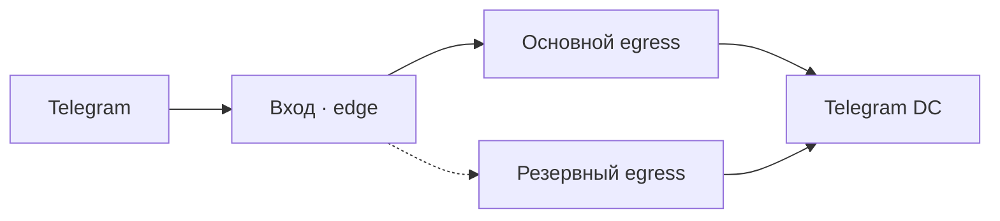

# mtevil

MTProto-прокси для Telegram на Rust. На одном Linux VPS мастер Docker Compose соберёт и запустит прокси, а затем выдаст ссылку для Telegram. Для нескольких серверов есть режим с основным и резервным выходом.

[Установка](#установка-на-один-vps) · [Как обновиться](#как-обновиться-и-управлять-прокси) · [Схема с резервом](#схема-с-резервом) · [Релизы](https://github.com/RsNest/mtevil/releases)

**Telegram:** [Релизы mtevil](https://t.me/mtevil_chat/22) · [Форум RU / EN, баги и предложения](https://t.me/mtevil_chat) · [Поддержка](https://t.me/mtevil_support_bot)


## Установка на один VPS

Понадобится Linux VPS с публичным IPv4, свободный входящий TCP-порт, Docker Engine с Compose v2, Python 3 и `curl`. Если используете домен, его DNS-запись `A` должна указывать на VPS. Проверьте, что выбранный порт открыт в firewall провайдера и сервера.

Подключитесь к VPS по SSH и выполните эти команды в Bash. Установщик скачает готовый образ и откроет мастер настройки.

```bash
curl -fsSL https://raw.githubusercontent.com/RsNest/mtevil/main/deploy/install.sh -o install.sh &&
  bash install.sh
```

1. Нажмите **Enter**, чтобы выбрать **Простую установку · один VPS** (`direct`).
2. Мастер сам определит публичный IPv4 и проверит порт `443` (если `443` занят — предложит свободный порт; если IPv4 не определится — попросит указать IP или домен). На экране подтверждения нажмите **Enter** (или введите `s` для быстрого выбора `SNI` из списка `ya.ru` / `vk.com` / `ozon.ru` / `example.com`, `a` для перехода в расширенную настройку, `n` для отмены).
3. Откройте готовую ссылку `https://t.me/proxy?...` в Telegram, нажмите «Подключить прокси» и проверьте отправку сообщения или загрузку медиа (включая мобильную сеть).

В штатном сценарии (определён публичный IPv4 и свободен порт `443`) простая установка требует всего **два нажатия Enter** (выбор режима и подтверждение). Для ручной настройки SNI/cover, IP привязки, `--network-host` или схемы `edge → egress` выберите пункт **2 (Расширенная настройка)** или передайте `--mode advanced` (см. [руководство по развёртыванию](deploy/README.md#интерактивный-мастер-установки-direct--egress--edge)).

По умолчанию файлы установки находятся в `~/mtevil`, старые временные скрипты `install.v*.sh` очищаются автоматически, а установщик выбирает свежий **стабильный** релиз (`vX.Y.Z`). При установке и обновлении проверяются контрольные суммы `SHA256SUMS`. Повторный запуск этой же команды обновляет существующую установку через мастер; сам выход нового релиза не перезапускает работающие VPS. Для предварительного релиза (`alpha`/`beta`/`rc`) укажите канал явно (`MTEVIL_CHANNEL=prerelease bash install.sh` или `bash install.sh --prerelease`) либо зафиксируйте тег: `MTEVIL_VERSION=v0.1.0-rc.1 bash install.sh`.

<details>
<summary>Установка из исходников</summary>

Для этого варианта нужен Git. Мастер соберёт образ внутри Docker.

```bash
git clone https://github.com/RsNest/mtevil.git
cd mtevil
python3 deploy/setup.py
```

</details>

## Как обновиться и управлять прокси

В каталог установки (`~/mtevil/mtevilctl`, а также в `~/.local/bin/mtevilctl` или `/usr/local/bin/mtevilctl`) устанавливается утилита `mtevilctl`. Обновление запускается вручную; сам выход нового релиза не перезапускает работающие VPS. При замене контейнера активные звонки и загрузки могут прерваться.

```bash
mtevilctl status                 # Текущая версия, роль, SNI, состояние контейнера, время работы и версия для отката
mtevilctl link                   # Показать текущую ссылку для подключения (--sni <домен>, --user <имя>, --all)
mtevilctl sni [домен]            # Сменить основной SNI (с сохранением работы прежних ссылок клиентов)
mtevilctl user add <имя>         # Добавить пользователя и вывести его ссылку (без перезапуска контейнера)
mtevilctl user list              # Показать список дополнительных пользователей (del <имя> — удалить)
mtevilctl setup                  # Запустить интерактивный мастер перенастройки текущей установки
mtevilctl update                 # Обновить до свежего стабильного релиза без повторного прохождения мастера
mtevilctl update --prerelease    # Обновить с учётом предварительных релизов (alpha/beta/rc)
mtevilctl rollback               # Вернуть предыдущий рабочий образ и конфигурацию одной командой (без интернета)
mtevilctl traffic                # Активные сессии, принятые/отправленные байты по участкам и период счётчиков
mtevilctl traffic --live         # Мониторинг в реальном времени (1 с): скорости, отключения, ретрансмиссии TCP (Ctrl+C — выход)
mtevilctl traf --live            # Короткий псевдоним для traffic
mtevilctl --help                 # Справка и примеры использования
```

- **`mtevilctl link` и `mtevilctl sni`:** выводят текущую ссылку или меняют домен маскировки (`SNI`) с проверкой TLS и Telegram DC. Предыдущие домены сохраняются в `/var/lib/mtevil/allowed-sni.txt` внутри тома `state`, поэтому **старые ссылки у пользователей продолжают работать без перенастройки**.
- **`mtevilctl user add|list|del`:** добавляет или отзывает персональные секреты и ссылки пользователей на лету (контейнер перечитывает `users.json` каждую секунду без перезапуска).
- **`mtevilctl setup`:** запускает интерактивный мастер перенастройки прямо на установленном каталоге (без повторного скачивания `install.sh`).
- **`mtevilctl update`:** по умолчанию выбирает свежий **стабильный** релиз (`MTEVIL_CHANNEL=stable`; для `alpha`/`beta`/`rc` используйте `--prerelease`, `MTEVIL_CHANNEL=prerelease` или `--version <тег>`). Команда проверяет `SHA256SUMS`, передаёт управление новому `setup.py` через `re-exec` до изменения `.env`, сохраняет роль, порт, режим сети (`--network-host`), пользователей, `allowed-sni.txt` и секреты. После запуска проверяются статус Docker `healthy` и сквозная проба до Telegram (`probe-telegram`); при 3 сбоях подряд автоматически возвращается прежний рабочий вариант.
- **`mtevilctl rollback`:** возвращает версию и конфигурацию, которые реально работали на этом VPS до обновления, без указания тега и без обращения к GitHub/GHCR.
- **`mtevilctl traffic` (`traf`):** учитывает только сокеты процесса `mtevil` (посторонний трафик VPS исключён даже при `--network-host`), на `edge` разделяет участки `клиент ↔ edge` и `edge ↔ egress`, а ретрансмиссии TCP показывает в сегментах (`TCP_INFO`), не выдавая их за процент потерь пакетов.

### Стабильность и скорость медиа
- **Выделенные медиа-DC и пул резервных IP:** запросы медиа (`DC -2`, `DC -4`) направляются на выделенные медиа-фронтенды Telegram (`149.154.167.151`, `149.154.167.220`, `149.154.166.120`, `149.154.167.92`) с чередованием и автоматическим переключением на резервный IP за `1.5 с`, если основной адрес не отвечает.
- **Оптимизированный путь данных:** без принудительного зажатия `TCP_MAXSEG=100`, с буферизованным `TlsReader` на входящем трафике клиента, быстрым `ServerHello` (`flight_shaping`) и отказоустойчивым `accept`-циклом (переживает `EMFILE`/`ENFILE`/`ENOBUFS`/`ECONNABORTED` с экспоненциальным backoff `10 мс .. 1 с` без падения процесса и обрыва активных сессий).

Для обновления установок с `v0.1.0-alpha.9` (до появления `re-exec`) сначала подгрузите актуальные `setup.py` и `mtevilctl` — пошаговая процедура описана в [руководстве по развёртыванию](deploy/README.md#переход-с-v010-alpha9).

Если нужно полностью изменить роль или параметры установки через интерактивный мастер (или если прокси был установлен до появления `mtevilctl`), выполните постоянную команду установки:

```bash
curl -fsSL https://raw.githubusercontent.com/RsNest/mtevil/main/deploy/install.sh -o install.sh &&
  bash install.sh
```

Для нестандартного каталога укажите путь через `MTEVIL_DIR`, например `MTEVIL_DIR="$HOME/mtevil-edge" mtevilctl update`. Для установки из исходников и ручного Docker Compose см. [обновление и откат](deploy/README.md#обновление-и-откат).

## Схема с резервом

В режиме `direct` клиент подключается к вашему VPS, который пересылает трафик в Telegram. Если нужен отдельный входной сервер и резервный выход, используйте `edge → egress`.



Сначала запустите мастер с ролью `egress` на выходных серверах, затем с ролью `edge` на входном. Узлы связываются по доступным адресам приватной сети. Подойдут, например, SharX, WireGuard или AmneziaWG.

В стратегии `ordered` новые подключения идут через основной egress. Если он недоступен, edge попробует резервный. Уже открытая сессия может оборваться. Telegram может подключиться снова по той же ссылке.

Порядок настройки, проверка `check-egress` и случай, когда нужен `--network-host`, описаны в [руководстве по развёртыванию](deploy/README.md).

## Что проверено и ограничения

- **Область проверки:** Linux (`x86_64`) и IPv4 в режимах `direct` и `edge → egress` (основной + резервный выход).
- **Клиенты Telegram:** `direct` и `edge` проверены в штатных клиентах на Windows, iOS и Android (подключение и передача сообщений/медиа по IPv4; для `v0.1.0-rc.1` запланирован контрольный регресс-smoke на Android по существующей ссылке).
- **Переключение на резерв под нагрузкой:** при внезапной остановке основного `egress` (`docker kill`) 30 из 30 параллельных внешних клиентов (вне контейнера `edge`) восстановили сквозную связь с Telegram через резервный `egress` за `2.54 с` (`0` ошибок, `p50 = 2205.6 мс`, `p95 = 2294.8 мс`; пик ресурсов на 4 vCPU Xeon E5-2698 v4 / 3.8 GiB RAM: `edge` — `3.13% CPU` / `2.87 MiB`, резервный `egress` — `33.98% CPU` / `1.28 MiB`).
- **Установка, обновление и откат:** проверены чистая установка, переход с нетронутой `v0.1.0-alpha.11` через `re-exec` с пробой Telegram и автоматический откат при сбое сквозной пробы Telegram на `healthy`-контейнере с сохранением исходной ссылки и секрета.
- **Известные ограничения:** сквозная работа по IPv6 не проверялась (поддерживается и проверен IPv4 на Linux `x86_64`).

## Документация

- [Развёртывание, диагностика, обновление и откат](deploy/README.md)
- [Архитектура и решения](docs/adr/000-architecture-baseline.md) · [Реализация ядра](docs/specs/prototype.md) · [Журнал проверок](docs/evidence-log.md)
