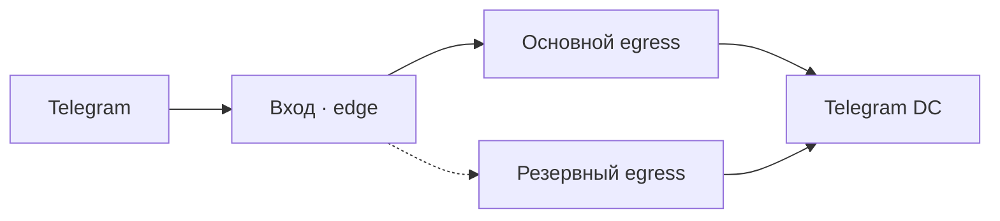

# mtevil

MTProto-прокси для Telegram на Rust. На одном Linux VPS мастер Docker Compose соберёт и запустит прокси, а затем выдаст ссылку для Telegram. Для нескольких серверов есть режим с основным и резервным выходом.

[Установка](#установка-на-один-vps) · [Схема с резервом](#схема-с-резервом) · [Обновление и диагностика](deploy/README.md) · [Релизы](https://github.com/RsNest/mtevil/releases)


## Установка на один VPS

Понадобится Linux VPS с публичным IPv4, свободный входящий TCP-порт, Docker Engine с Compose v2, Python 3 и `curl`. Если используете домен, его DNS-запись `A` должна указывать на VPS. Проверьте, что выбранный порт открыт в firewall провайдера и сервера.

Подключитесь к VPS по SSH и выполните эти команды в Bash. Установщик скачает готовый образ и откроет мастер настройки.

```bash
curl -fsSL https://github.com/RsNest/mtevil/releases/download/v0.1.0-alpha.4/install.sh -o install.sh &&
  bash install.sh
```

1. Нажмите **Enter**, чтобы выбрать подключение через один зарубежный сервер (`direct`).
2. Введите публичный IP или домен сервера. Для порта оставьте `443`, если он свободен, или укажите другой — при занятом порте мастер сам предложит свободный вариант.
3. По умолчанию для HTTPS-маскировки используется `example.com:443` (его можно поменять в «Расширенных настройках»).
4. Откройте ссылку, которую выдаст мастер, в Telegram и нажмите «Подключить прокси». Для проверки переключитесь на мобильную сеть и откройте фото или видео в чате.

Команда выше устанавливает [релиз `v0.1.0-alpha.4`](https://github.com/RsNest/mtevil/releases/tag/v0.1.0-alpha.4). В нём каталог ещё называется `~/mtveil`. В новой версии установщика каталог называется `~/mtevil`. При обновлении прежней установки этот путь ведёт к уже имеющимся файлам, а Docker продолжает использовать тот же том с секретами.

<details>
<summary>Установка из исходников</summary>

Для этого варианта нужен Git. Мастер соберёт образ внутри Docker.

```bash
git clone https://github.com/RsNest/mtevil.git
cd mtevil
python3 deploy/setup.py
```

</details>

## Схема с резервом

В режиме `direct` клиент подключается к вашему VPS, который пересылает трафик в Telegram. Если нужен отдельный входной сервер и резервный выход, используйте `edge → egress`.



Сначала запустите мастер с ролью `egress` на выходных серверах, затем с ролью `edge` на входном. Узлы связываются по доступным адресам приватной сети. Подойдут, например, SharX, WireGuard или AmneziaWG.

В стратегии `ordered` новые подключения идут через основной egress. Если он недоступен, edge попробует резервный. Уже открытая сессия может оборваться. Telegram может подключиться снова по той же ссылке.

Порядок настройки, проверка `check-egress` и случай, когда нужен `--network-host`, описаны в [руководстве по развёртыванию](deploy/README.md).

## Что проверено

- `direct` и `edge` проверены в штатных клиентах Telegram на Windows и iOS. Подключение и передача медиа проверены по IPv4 через Wi-Fi и мобильную сеть.
- Переключение после остановки основного egress подтверждено отдельным сквозным тестом. Новая сессия прошла через резервный узел.
- Мастер проверяет конфигурацию и HTTPS-cover перед запуском. В ядре доступны отдельные секреты для пользователей и replay-кэш с сохранением на диск.

Проект на стадии alpha. Сквозной запуск по IPv6 пока не проверен.

## Документация

- [Развёртывание, диагностика, обновление и откат](deploy/README.md)
- [Архитектура и решения](docs/adr/000-architecture-baseline.md) · [Реализация ядра](docs/specs/prototype.md) · [Журнал проверок](docs/evidence-log.md)
