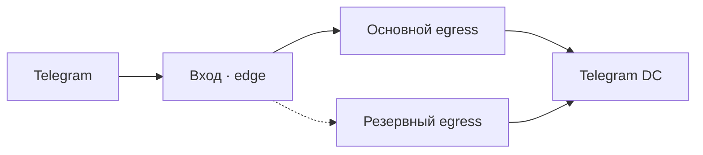

# mtevil

MTProto-прокси для Telegram на Rust. На одном Linux VPS мастер Docker Compose соберёт и запустит прокси, а затем выдаст ссылку для Telegram. Для нескольких серверов есть режим с основным и резервным выходом.

[Установка](#установка-на-один-vps) · [Как обновиться](#как-обновиться-и-управлять-прокси) · [Схема с резервом](#схема-с-резервом) · [Релизы](https://github.com/RsNest/mtevil/releases)

**Telegram:** [Релизы mtevil](https://t.me/mtevil_chat/22) · [Форум RU / EN, баги и предложения](https://t.me/mtevil_chat) · [Поддержка](https://t.me/mtevil_support_bot)


## Установка на один VPS

Понадобится Linux VPS с публичным IPv4, свободный входящий TCP-порт, Docker Engine с Compose v2, Python 3 и `curl`. Если используете домен, его DNS-запись `A` должна указывать на VPS. Проверьте, что выбранный порт открыт в firewall провайдера и сервера.

Подключитесь к VPS по SSH и выполните эти команды в Bash. Установщик скачает готовый образ и откроет мастер настройки.

```bash
curl -fsSL https://raw.githubusercontent.com/RsNest/mtevil/main/deploy/install.sh -o install.sh &&
  bash install.sh
```

1. Нажмите **Enter**, чтобы выбрать **Простую установку · один VPS** (`direct`).
2. Мастер сам определит публичный IPv4 и проверит порт `443` (если `443` занят — предложит свободный порт; если IPv4 не определится — попросит указать IP или домен). На экране подтверждения нажмите **Enter** (или введите `s` для быстрого выбора `SNI` из списка `ya.ru` / `vk.com` / `ozon.ru` / `example.com`, `a` для перехода в расширенную настройку, `n` для отмены).
3. Откройте готовую ссылку `https://t.me/proxy?...` в Telegram, нажмите «Подключить прокси» и проверьте отправку сообщения или загрузку медиа (включая мобильную сеть).

В штатном сценарии (определён публичный IPv4 и свободен порт `443`) простая установка требует всего **два нажатия Enter** (выбор режима и подтверждение). Для ручной настройки SNI/cover, IP привязки, `--network-host` или схемы `edge → egress` выберите пункт **2 (Расширенная настройка)** или передайте `--mode advanced` (см. [руководство по развёртыванию](deploy/README.md#интерактивный-мастер-установки-direct--egress--edge)).

По умолчанию файлы установки находятся в `~/mtevil`, старые временные скрипты `install.v*.sh` очищаются автоматически, а установщик выбирает свежий **стабильный** релиз (`vX.Y.Z`). При установке и обновлении проверяются контрольные суммы `SHA256SUMS`. Повторный запуск этой же команды обновляет существующую установку через мастер; сам выход нового релиза не перезапускает работающие VPS. Для предварительного релиза (`alpha`/`beta`/`rc`) укажите канал явно (`MTEVIL_CHANNEL=prerelease bash install.sh` или `bash install.sh --prerelease`) либо зафиксируйте тег: `MTEVIL_VERSION=v0.1.0-rc.1 bash install.sh`.

<details>
<summary>Установка из исходников</summary>

Для этого варианта нужен Git. Мастер соберёт образ внутри Docker.

```bash
git clone https://github.com/RsNest/mtevil.git
cd mtevil
python3 deploy/setup.py
```

</details>

### Режим `self-steal` (свой локальный HTTPS-сайт как cover)

Если на сервере уже поднят `nginx` или `Caddy` с настоящим сайтом и сертификатом, можно запустить мастер в режиме **`self-steal`** (`mtevilctl setup --self-steal` или пункт **3**): `mtevil` слушает внешний порт `443`, а обычные HTTPS-запросы (браузер, активные проверки) проксирует на ваш локальный сайт (например, `127.0.0.1:8443`). **Формат FakeTLS-ответа для клиентов Telegram в этом режиме не менялся.**

- **Предусловия:** `A`-запись домена указывает на IP сервера без CDN-проксирования, на локальном бэкенде включён TLS 1.3 и размещён реальный сайт (не страница по умолчанию). Сертификат выпускается и продлевается без порта `443` (через `HTTP-01` на `80` или `DNS-01`), домен попадает в публичные логи Certificate Transparency.
- **Компромиссы и ограничения:** свой домен и IP можно заблокировать без коллатерального ущерба для цензора (в отличие от популярного чужого домена); режимы белых списков и репутация нового домена могут не пройти; домен привязан к вам, в журналах веб-сервера виден `127.0.0.1` (а не адрес посетителя), сайт и сертификат нужно поддерживать самостоятельно; срез клиентского `ClientHello` до ответа сервера `self-steal` не устраняет.
- Подробная инструкция (`nginx`-конфиг на `127.0.0.1:8443`, получение/мониторинг сертификата и откат) — в [deploy/README.md](deploy/README.md#режим-self-steal-маскировка-под-собственный-локальный-https-сайт).

## Как обновиться и управлять прокси

В каталог установки (`~/mtevil/mtevilctl`, а также в `~/.local/bin/mtevilctl` или `/usr/local/bin/mtevilctl`) устанавливается утилита `mtevilctl`. Обновление запускается вручную; сам выход нового релиза не перезапускает работающие VPS. При замене контейнера активные звонки и загрузки могут прерваться.

```bash
mtevilctl status                 # Текущая версия, роль, SNI, состояние контейнера, время работы и версия для отката
mtevilctl link                   # Показать текущую ссылку для подключения (--sni <домен>, --user <имя>, --all)
mtevilctl sni [домен]            # Сменить основной SNI (с сохранением работы прежних ссылок клиентов)
mtevilctl user add <имя>         # Добавить пользователя и вывести его ссылку (без перезапуска контейнера)
mtevilctl user list              # Показать список дополнительных пользователей (del <имя> — удалить)
mtevilctl adtag set              # Задать рекламный тег ME (@MTProxybot) через скрытый ввод без истории shell
mtevilctl adtag show             # Показать статус рекламного тега (значение маскируется)
mtevilctl adtag clear            # Удалить рекламный тег ME
mtevilctl setup                  # Запустить интерактивный мастер перенастройки текущей установки
mtevilctl update                 # Обновить до свежего стабильного релиза без повторного прохождения мастера
mtevilctl update --prerelease    # Обновить с учётом предварительных релизов (alpha/beta/rc)
mtevilctl rollback               # Вернуть предыдущий рабочий образ и конфигурацию одной командой (без интернета)
mtevilctl traffic                # Активные сессии, принятые/отправленные байты по участкам и период счётчиков
mtevilctl traffic --live         # Мониторинг в реальном времени (1 с): скорости, отключения, ретрансмиссии TCP (Ctrl+C — выход)
mtevilctl traf --live            # Короткий псевдоним для traffic
mtevilctl --help                 # Справка и примеры использования
```

- **`mtevilctl link` и `mtevilctl sni`:** выводят текущую ссылку или меняют домен маскировки (`SNI`) с проверкой TLS и Telegram DC. Предыдущие домены сохраняются в `/var/lib/mtevil/allowed-sni.txt` внутри тома `state`, поэтому **старые ссылки у пользователей продолжают работать без перенастройки**.
- **`mtevilctl user add|list|del`:** добавляет или отзывает персональные секреты и ссылки пользователей на лету (контейнер перечитывает `users.json` каждую секунду без перезапуска).
- **`mtevilctl adtag set|show|clear`:** управляет рекламным тегом Telegram Middle-End (`ad_tag` из `@MTProxybot`, 32 hex-символа) без перезапуска контейнера. Используйте `mtevilctl adtag set` **без аргумента** (скрытый ввод / stdin) — передача тега аргументом в командной строке сохраняет его в истории shell. Файл хранится в томе `state` с правами `0600` и владельцем `10001:10001`.
- **`mtevilctl setup`:** запускает интерактивный мастер перенастройки прямо на установленном каталоге (без повторного скачивания `install.sh`).
- **`mtevilctl update`:** по умолчанию выбирает свежий **стабильный** релиз (`MTEVIL_CHANNEL=stable`; для `alpha`/`beta`/`rc` используйте `--prerelease`, `MTEVIL_CHANNEL=prerelease` или `--version <тег>`). Команда проверяет `SHA256SUMS`, передаёт управление новому `setup.py` через `re-exec` до изменения `.env`, сохраняет роль, порт, режим сети (`--network-host`), пользователей, `allowed-sni.txt` и секреты. В схеме `edge → egress` **сначала обновляйте все узлы `egress`, затем `edge`**. После запуска проверяются статус Docker `healthy` и сквозная проба до Telegram (`probe-telegram`); при 3 сбоях подряд автоматически возвращается прежний рабочий вариант. При понижении на `v0.2.0` (`mtevilctl update --version v0.2.0`) несовместимый блок `me` автоматически вырезается из `config.json` с сохранением исходного файла в `config.json.pre-me-downgrade` (`0600`).
- **`mtevilctl rollback`:** возвращает версию и конфигурацию, которые реально работали на этом VPS до обновления, без указания тега и без обращения к GitHub/GHCR. При откате на `v0.2.0` блок `me` при необходимости также снимается с сохранением резервной копии `.pre-me-downgrade`.
- **`mtevilctl traffic` (`traf`):** учитывает только сокеты процесса `mtevil` (посторонний трафик VPS исключён даже при `--network-host`), на `edge` разделяет участки `клиент ↔ edge` и `edge ↔ egress`, а ретрансмиссии TCP показывает в сегментах (`TCP_INFO`), не выдавая их за процент потерь пакетов. Для Prometheus также доступен опциональный localhost-only эндпоинт `/metrics` (`metrics_listen`, например `127.0.0.1:9108`, выключен по умолчанию).

### Стабильность и скорость медиа
- **Выделенные медиа-DC и пул резервных IP:** запросы медиа (`DC -2`, `DC -4`) направляются на выделенные медиа-фронтенды Telegram (`149.154.167.151`, `149.154.167.220`, `149.154.166.120`, `149.154.167.92`, настраиваются через `dc_media_override`) с чередованием и автоматическим переключением на резервный IP за `1.5 с`, если основной адрес не отвечает. На `direct` и `egress` каждые `60 с` (`dc_probe_interval_secs`) выполняется фоновая самопроверка достижимости DC (метрики `dc_self_check_ok` / `dc_self_check_failed` и событие `dc_self_check`, без вмешательства в маршрутизацию клиентов).
- **Оптимизированный путь данных:** без принудительного зажатия `TCP_MAXSEG=100`, с буферизованным `TlsReader` на входящем трафике клиента, быстрым `ServerHello` (`flight_shaping`), периодическим семплированием `TCP_INFO` раз в `1 с` (+ при закрытии, вместо syscall на каждый пакет) и отключаемой трассировкой чанков (`diagnostics = false` по умолчанию), фоновым DNS-резолвером для `cover` с TTL-кэшем и `last-known-good` (без блокировки data-потоков при сбое DNS), персистентным replay-кэшем (`/var/lib/mtevil/replay.bin` с атомарным `tmp + fsync + rename` и защитой от повреждения файла при старте), контролем бюджета файловых дескрипторов (`RLIMIT_NOFILE`) и отказоустойчивым `accept`-циклом (переживает `EMFILE`/`ENFILE`/`ENOBUFS`/`ECONNABORTED` с экспоненциальным backoff `10 мс .. 1 с` без падения процесса и обрыва активных сессий).

Для обновления установок с `v0.1.0-alpha.9` (до появления `re-exec`) сначала подгрузите актуальные `setup.py` и `mtevilctl` — пошаговая процедура описана в [руководстве по развёртыванию](deploy/README.md#переход-с-v010-alpha9).

Если нужно полностью изменить роль или параметры установки через интерактивный мастер (или если прокси был установлен до появления `mtevilctl`), выполните постоянную команду установки:

```bash
curl -fsSL https://raw.githubusercontent.com/RsNest/mtevil/main/deploy/install.sh -o install.sh &&
  bash install.sh
```

Для нестандартного каталога укажите путь через `MTEVIL_DIR`, например `MTEVIL_DIR="$HOME/mtevil-edge" mtevilctl update`. Для установки из исходников и ручного Docker Compose см. [обновление и откат](deploy/README.md#обновление-и-откат).

## Схема с резервом

В режиме `direct` клиент подключается к вашему VPS, который пересылает трафик в Telegram. Если нужен отдельный входной сервер и резервный выход, используйте `edge → egress`.



Сначала запустите мастер с ролью `egress` на выходных серверах, затем с ролью `edge` на входном. Узлы связываются по доступным адресам приватной сети. Подойдут, например, SharX, WireGuard или AmneziaWG.

В стратегии `ordered` новые подключения идут через основной egress (с hedged connect через `400 мс` на резервный выход при задержке ACK), а в `round-robin` — чередуются по кругу с пропуском узлов в cooldown (circuit breaker работает в обеих стратегиях с экспоненциальным backoff `3..60 с` `±20%` jitter, fail-open пробой при одновременном cooldown всех узлов и фоновым пробингом `30 с / 5 с` по DC `2, 4, -2, -4` для автоматического failback). Между `edge` и `egress` используется аутентифицированный префейс `MTV3` (`HMAC-SHA256` по токену, `timestamp` с окном `±30 с` и `nonce` с защитой от повтора, с обратной совместимостью с `MTV2` при `egress_accept_legacy = true`), а при включённом ME-режиме — `MTV4` с поддержкой `ad_tag` и автоматическим fallback на Direct (`MTV3`) при недоступности ME или несовместимом `egress v0.2.0`. При обновлении схемы `edge → egress` всегда обновляйте сначала `egress`, затем `edge`. Уже открытая сессия может оборваться. Telegram может подключиться снова по той же ссылке.

Порядок настройки, проверка `check-egress` и случай, когда нужен `--network-host`, описаны в [руководстве по развёртыванию](deploy/README.md).

## Режим Middle-End (ME) и `ad_tag`

По умолчанию ME-режим **выключен** (`me.enabled = false`), существующие установки и конфиги работают в режиме Direct без изменений. При включении ME (`mtevilctl setup` → расширенная настройка или блок `"me"` в `config.json`) `mtevil` поддерживает пул постоянных шифрованных соединений к Middle-End серверам Telegram (`pool_size = 2` по умолчанию), автоматически обновляет `proxy-secret` и `proxy-multi.conf` с `core.telegram.org` (с `last-known-good` кэшем в томе `replay`) и поддерживает рекламный тег `@MTProxybot` (`mtevilctl adtag set`). При недоступности ME и `me.fallback_to_direct = true` (по умолчанию) новые соединения прозрачно переключаются на Direct.

### Приватность

- В режиме Direct Telegram видит только IP-адрес вашего прокси-сервера.
- В режиме ME при настройке по умолчанию `me.send_client_ip = true` в `RPC_PROXY_REQ` передаётся **реальный IPv4-адрес клиента** (как в официальном MTProxy).
- При включённом `proxy_protocol` клиентский IPv4 берётся из заголовка PROXY protocol v2.
- Для чистых IPv6-клиентов в `RPC_PROXY_REQ` детерминированно передаётся нулевой адрес `0.0.0.0:0`.
- В схеме `edge → egress` передача IP клиента активна только если `me.send_client_ip = true` на **обоих** узлах (AND-логика); на `egress` клиентский IP никогда не пишется в логи и метрики.
- Режим `me.send_client_ip = false` (всегда `0.0.0.0:0`) помечен как **экспериментальный** до проверки полной пользовательской сессии реальным клиентом Telegram.

### NAT и Docker bridge

- Для рукопожатия ME (`RPC_HANDSHAKE` KDF) сервер должен знать свой внешний IPv4-адрес.
- Автоопределения внешнего IPv4 в ядре `mtevil` нет: при `me.public_ipv4 = null` используется локальный адрес сокета (`local_addr`), что работает **только** когда публичный IPv4 назначен прямо на интерфейс контейнера (`--network=host` на VPS без NAT).
- За 1:1 NAT или в стандартной Docker `bridge`-сети параметр `me.public_ipv4` **обязателен** (мастер `mtevilctl setup` запрашивает его автоматически). Подробнее см. [ADR-002](docs/adr/002-me-mode.md) и [инструкцию ручной проверки ME](docs/me-manual-test.md).

## Что проверено и ограничения

- **Область проверки:** Linux (`x86_64`) и IPv4 в режимах `direct` и `edge → egress` (основной + резервный выход), Direct и Middle-End (ME / `MTV4`).
- **Клиенты Telegram (Direct и ME с `ad_tag`):** `direct` и `edge` проверены в штатных клиентах на Windows, iOS и Android (подключение и передача сообщений/медиа по IPv4). Дополнительно выполнена ручная проверка режима ME с реальным `ad_tag` из `@MTProxybot` на тестовом VPS (2 пользователя, реальные клиенты Telegram на ПК и телефоне): подключение, сообщения, медиа и отображение спонсорского канала работают (показ спонсорского канала в клиенте может появляться не сразу), `ME активен 24/24`, `fallback=0`, потерь очередей и ретрансмиссий TCP нет (`~9 МиБ` RAM), `ad_tag` и IP клиента в логах отсутствуют.
- **Регрессия Direct (`me.enabled = false`, `v0.2.0` vs `v0.3.0`, 10 чередующихся прогонов × 30 параллельных клиентов = 300 проб на сценарий, без `docker exec`):** `0/300` ошибок во всех 4 сценариях (`direct`, `split docker kill`, `split blackhole`, `split both down`); медиана `direct` — `222.3 мс` (`p95 = 355.6 мс`), `split docker kill` — `626.8 мс` (`p95 = 733.0 мс`), `split blackhole` — `677.4 мс` (`p95 = 797.3 мс`), `split both down` — `230.5 мс` (`p95 = 334.0 мс`).
- **Нагрузка ME (реальный Telegram ME, `pool_size = 2` по умолчанию):** волны 30 и 100 параллельных сессий — `0` ошибок, `0` `backpressure_drops`, `0` `dropped_close_ext`, `0` fallback (`147.6 мс` для 30 и `576.3 мс` для 100 сессий).
- **Установка, обновление и откат:** проверены чистая установка, обновление `v0.2.0 → v0.3.0` (`direct` и `edge → egress` в порядке `egress` → `edge`) с сохранением пользовательских правок `compose.yaml` и пользователей, `mtevilctl rollback` на `v0.2.0` и даунгрейд `mtevilctl update --version v0.2.0` с включённым ME (автоматический `strip` блока `me` и сохранение `.pre-me-downgrade`).
- **Известные ограничения:**
  - `edge` является единой точкой отказа (SPOF).
  - Сквозная работа по IPv6 не проверялась (поддерживается и проверен IPv4 на Linux `x86_64`).
  - Режим ME проверен на тестовом Linux VPS (волны до 100 сессий, все 3 транспорта, split `MTV4` и ручная сессия на ПК и телефоне с реальным `ad_tag`), но **не** под массовой пользовательской нагрузкой; режим `me.send_client_ip = false` (`0.0.0.0:0`) с реальным клиентом Telegram не проверялся и остаётся экспериментальным. Показ спонсорского канала у клиентов может появляться не сразу. Инструкция для самостоятельной проверки — [docs/me-manual-test.md](docs/me-manual-test.md).

## Документация

- [Развёртывание, диагностика, обновление и откат](deploy/README.md)
- [Архитектура и решения](docs/adr/000-architecture-baseline.md) · [ADR-002: ME-режим и `ad_tag`](docs/adr/002-me-mode.md) · [Реализация ядра](docs/specs/prototype.md) · [Журнал проверок](docs/evidence-log.md)
