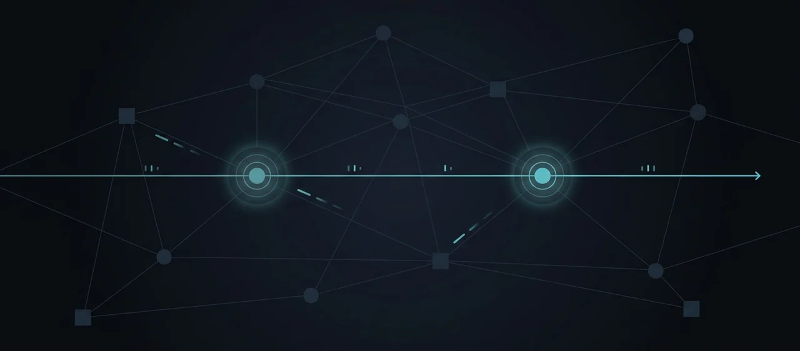
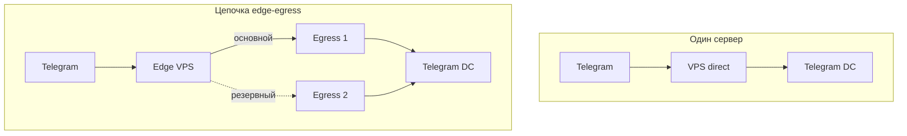

# mtveil

**mtveil** — это MTProto-прокси для Telegram на Rust с интерактивным установщиком на Docker Compose и опциональным резервированием через цепочку `edge → egress` ([RsNest/mtevil](https://github.com/RsNest/mtevil)).

---

## Быстрый старт на одном VPS (`direct`)

Если вы поднимаете прокси на одном зарубежном Linux-сервере впервые, этого варианта достаточно. Установка занимает пару минут и не требует ручного редактирования конфигов.

### Что понадобится заранее

- **Linux VPS** за пределами РФ с открытым входящим TCP-портом (обычно `443` или любой свободный порт).
- **Docker Engine** и плагин **Docker Compose v2** (`docker compose version`).
- **Python 3** и **Git** (для сборки из исходников).

### Установка из исходников (доступна сейчас)

Подключитесь к серверу по SSH и выполните:

```bash
git clone https://github.com/RsNest/mtevil.git
cd mtevil
python3 deploy/setup.py
```

Что выбрать в мастере:

1. На первом шаге выберите роль **`1` (`direct`)** — она предложена по умолчанию.
2. Укажите публичный IP или домен вашего VPS (например, `203.0.113.10` или `proxy.example.com`) и порт публикации (например, `443`).
3. Для HTTPS-маскировки (cover) оставьте `example.com` или укажите свой домен — мастер сам проверит TLS-рукопожатие и сертификат изнутри контейнера.

После запуска мастер выведет готовую ссылку вида `https://t.me/proxy?server=...&port=...&secret=...`.

### Как проверить прокси в Telegram

1. Откройте полученную ссылку на телефоне (попробуйте и по Wi-Fi, и с мобильного интернета) или на компьютере и подтвердите добавление прокси.
2. Откройте любой чат или канал и **загрузите фото** — это проверяет не только рукопожатие, но и передачу медиафайлов.

### Установка без сборки и `git clone` (ожидает публикации релиза)

> [!NOTE]
> Артефакты релиза `v0.1.0-alpha.2` (`install.sh`, `setup.py` и публичный образ в GHCR) ещё не опубликованы. Пока они недоступны, используйте установку из исходников выше.

Когда релиз и публичный образ будут опубликованы, для установки достаточно двух команд:

```bash
curl -fsSL https://github.com/RsNest/mtevil/releases/download/v0.1.0-alpha.2/install.sh -o install.sh
bash install.sh
```

---

## Варианты развёртывания

Для большинства задач хватает **одного зарубежного VPS (`direct`)**. Схема **`edge → egress`** нужна, если вы хотите принимать клиентов на узле в РФ (`edge`) и пересылать трафик через один или несколько зарубежных узлов (`egress`) по приватному туннелю.



- **Один сервер (`direct`):** минимальная задержка и простая настройка; подойдёт, если зарубежный сервер стабильно доступен напрямую.
- **Цепочка (`edge → egress`):** `edge` принимает подключения клиентов и открывает соединения к `egress` по приватному туннелю (SharX, WireGuard или AmneziaWG). При отказе основного `egress` активные сессии на нём могут оборваться, Telegram на секунду покажет «Подключение…» с той же ссылкой, а **новые подключения** автоматически пойдут на резервный `egress`.

Подробная инструкция для нескольких узлов — роли, настройка приватных маршрутов, диагностика `check-egress` и флаг `--network-host` для policy-routed туннелей — вынесена в [руководство по развёртыванию](deploy/README.md).

---

## Что умеет текущая версия и что проверено

- **Защита и маскировка:** FakeTLS (`ee`) с проверкой внешнего HTTPS-cover на стадии настройки, персистентным replay-кэшем на диске и формированием пакетов при старте соединения (`flight_shaping`, настройка MSS).
- **Несколько пользователей:** поддержка отдельных секретов через `users_file` и команду `mtveil user-add`.
- **Управление и диагностика:** встроенный `healthcheck`, проверка туннелей `mtveil check-egress`, сохранение секретов/токенов в Docker volume и резервные копии `*.bak` при перенастройке.
- **Проверено на практике (IPv4):** отправка сообщений, загрузка фото и медиа по IPv4 на Telegram Desktop (Windows) и iOS (Wi-Fi и мобильная сеть) как в режиме `direct`, так и в схеме `edge → egress` с переключением на резервный узел. Сквозная работа по **IPv6** на реальных серверах пока не проверялась, поэтому для клиентских ссылок используйте IPv4.

---

## Архитектура и документация

Детали протокола, спецификации и архитектурные решения собраны отдельно, чтобы не перегружать установку:

- [Руководство по развёртыванию, обновлению и откату](deploy/README.md) · [setup.py](deploy/setup.py) · [compose.yaml](deploy/compose.yaml)
- [Архитектурный baseline (ADR-000)](docs/adr/000-architecture-baseline.md) и [прототип ядра (ADR-001)](docs/adr/001-own-core-prototype.md)
- [Контракт прототипа](docs/specs/prototype.md) · [FakeTLS-профиль](docs/specs/fake-tls-profile.md) · [Phase 0](docs/specs/phase-0.md)
- [Матрица отказов](docs/failure-matrix.md) и [журнал проверок](docs/evidence-log.md)
